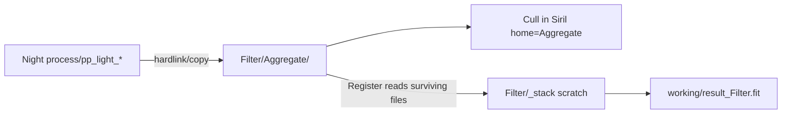

# Aggregate step before Cull

## Where the pool lives

Use a dedicated folder **per filter channel**, next to that filter’s night shoots:

`<projectDir>/<Filter>/Aggregate/`

Examples:
- `…/NGC6960_Q326/Ha/Aggregate/`
- `…/NGC6960_Q326/OIII/Aggregate/`
- `…/NGC6960_Q326/SII/Aggregate/`

Same channel grouping as Cull/Register (one pool per filter name/tone; locations for that filter share it). Not a single project-wide Aggregate.

**Why not `_stack/inputs/`:** `_stack` is Siril scratch (convert/register/seq junk). A top-level `Aggregate` folder is the right Siril “home” for culling — easy to find, stable, not wiped by stack intermediates.

**Links:** hardlink-first via existing `ensureLinkOrCopy` (copy fallback). Prefer hardlinks over symlinks on Windows (same dangling/0-byte issues as Dark Library).

**Naming in Aggregate:** renumbered `pp_light_#####.fit` across nights (same as today’s gather). Optional night provenance can live in aggregate meta / a small manifest later — not required for v1.

## Pipeline chrome

Trunk: **Aggregate → Cull → Register** (per filter).

- Night rails unchanged: Capture → Import → Calibrate
- SVG fan-in sink on **Aggregate**
- Widen `--pipeline-trunk-w` for 3 steps
- Green: fan-in greens when Aggregate done; Aggregate→Cull gray until Cull done; Cull→Register gray until Register done

## Aggregate confirm popup

Clicking the Aggregate dot opens the existing pipeline job confirm pattern ([`openPipelineJobConfirm`](index.html)), not an instant run.

Modal contents:
- Filter, night count, frame count estimate (sum of calibrated `pp_light_*`)
- Destination path with **Copy path** button (and clickable path using existing clipboard helper)
- List of nights included
- Notes: hardlinks into `Aggregate/`; re-run rebuilds the folder and clears Cull + Register
- Primary button: **Aggregate** (or **Re-aggregate** if already done)

After success (progress modal / banner):
- Show path again with **Copy path** + **Open folder**
- Copy path is the “set Siril home” affordance for now (no Siril automation)

## Behavior

**Aggregate:**
1. Collect calibrated shoot dirs for that filter tone
2. Rebuild `Filter/Aggregate/` fresh (rm + mkdir)
3. Hardlink/copy all night `process/pp_light_*` into Aggregate (renumbered)
4. Stamp `filterTarget.aggregateMeta`: `aggregatedAt`, `aggregateDir`, `frameCount`, `shootCount`

**Cull:** still mark-done stub; titles point at `Filter/Aggregate/`. Prefer opening/copying that path from Aggregate modal after success.

**Register:** do **not** re-gather from nights. Require Aggregate done; take surviving FITS from `Filter/Aggregate/` into `_stack` for Siril register/stack (or point stack inputs at Aggregate copies). Missing/deleted files after cull are simply absent. Writes `working/result_<Filter>.fit` + `stackMeta`.

**Gates:**
- Aggregate: ≥1 calibrated night + projectDir
- Cull: Aggregate done
- Register: Cull done

**Invalidation:** re-calibrate clears `aggregateMeta` + `cullMeta` + `stackMeta`. Re-aggregate clears cull + stack and rebuilds `Aggregate/`.

## Code touch points

- [`src/siril/preprocess.js`](src/siril/preprocess.js): `aggregateFilter({ projectDir, filter, shootDirs })` → `…/Filter/Aggregate/`; `stackFilter` sources from Aggregate
- [`main.js`](main.js) / preload: `zuko-siril-aggregate` / `zukoSiril.aggregate`
- [`index.html`](index.html): trunk UI, confirm modal with copy-path, meta helpers, CSS trunk width, working-notes

## Out of scope

In-app cull UI; auto-launch Siril with home dir set.
