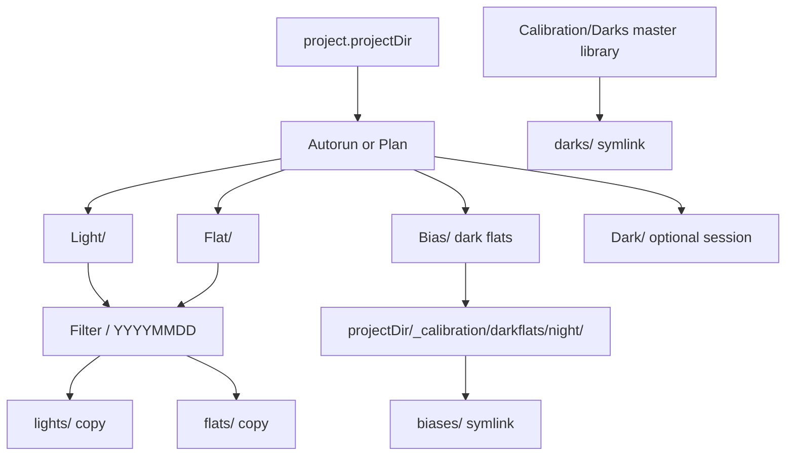

# ASIAIR Ingest Redesign

## Intent

You did not define the old layout — it was a prior default. This redesign matches your real workflow and the Desktop `Autorun` sample (`Light/<Target>/`, `Flat`, `Bias`, `Dark`; FITS + `_thn.jpg` thumbnails ignored).

**Chosen defaults** (change anytime if wrong):
- Master dark library default: `H:\Photography\Astrophotography\Calibration\Darks` (editable in a new Calibration UI).
- One Ingest from a shoot stages **all filters found for that astronomical night** into Siril folders; the shoot’s filter is highlighted for shoot-log confirmation. Biases (dark flats) are shared across channels via symlink.

## Local staging fixture

On implement, build a **trimmed** work area from the Desktop dump (move or copy-then-prune — prefer move of needed pieces into staging, leave unrelated Desktop data behind or delete NGC 7000 from the staging copy only):

- Destination: `staging/asiair-sample/` (fake `project.projectDir`)
- Session: `staging/asiair-sample/Autorun/` with `Light` / `Flat` / `Bias` / `Dark`
- **Lights only for NGC 6960:** keep `Light/NGC 6960/` (FITS nights `20260725`–`20260726` in filenames). Do **not** include `Light/NGC 7000/`.
- Add `staging/` to [`.gitignore`](.gitignore) so FITS never get committed.
- Point a test project’s `projectDir` at `staging/asiair-sample`.

**Discriminators for target selection** (staging + ingest):
1. FITS header `OBJECT` / related (preferred)
2. `Light/<Target>/` folder name (fallback)
3. Filename target token (last resort)

Folder filesystem “date created” is **not** used (unreliable after copies).

Ingest scan must support ASIAIR’s real Light layout:

```text
Autorun/Light/<TargetName>/*.fit
```

not only flat `Autorun/Light/*.fit`. Flat/Bias/Dark may stay session-level (as in this dump) and are matched by night/filter/metadata rather than target folder.

## Target layout



Siril staging under the project directory:

```text
<projectDir>/
  Autorun/   (or Plan/)          # ASIAIR dump already present
  _calibration/
    darkflats/<YYYYMMDD>/        # moved Bias/*.fit (dark flats) live here
  <Filter>/                      # Ha, OIII, SII, ...
    <YYYYMMDD>/                  # night date (evening start date)
      lights/                    # COPY of matching Light FITS
      flats/                     # COPY of matching Flat FITS for that filter
      biases/                    # SYMLINK → _calibration/darkflats/<night>/
      darks/                     # SYMLINK → matched master-library darks
```

Only `.fit`/`.fits`/`.fts` are staged (skip `_thn.jpg`).

## Metadata priority (FITS headers first)

Prefer **FITS header keywords** over filenames or folder names whenever present. Filenames / `Light/<Target>/` are fallbacks only.

Typical fields to read (already partially supported in [`asiairIngest.js`](src/ingest/asiairIngest.js) via `readFitsHeaderKeywords` / `mergeHeaderIntoParsed`):

- Night / time: `DATE-OBS` (and related) — drive D / D+1 night window and morning wrap
- Exposure: `EXPTIME` / `EXPOSURE`
- Gain: `GAIN` (or camera-specific equivalents when present)
- Temperature: `CCD-TEMP` / `SET-TEMP` / similar — dark matching uses header temp (±3°C)
- Filter: `FILTER` — channel split and flat matching
- Object/target: `OBJECT` — prefer over `Light/<folder>` name when choosing NGC 6960 vs others
- Frame type: `IMAGETYP` / `FRAME` when available; else folder (`Light`/`Flat`/`Bias`/`Dark`) + filename prefix

Scan/stage flows should **always enable header reads** for lights (and for dark-library indexing). Filename parsing remains for quick triage and when headers are missing/corrupt.

## Night matching

Shoot date `D` (evening) accepts frames whose **header `DATE-OBS`** (else filename stamp) falls on **`D` or `D+1`**. If time is present, hours `00:00–11:59` belong to the previous evening’s night label `D`.

## UI / data model

1. **`project.projectDir`** (string path) on each project — required for ingest. Add path field + Browse in project edit modal; show in project meta.
2. Shoot Log: rename **Attach folder… / Re-ingest** → **Ingest** (opens modal, no immediate OS folder picker for the dump — scan `projectDir` instead).
3. **Ingest modal** (new large modal in [`index.html`](index.html)):
   - Detect sessions: child folders named `Autorun` / `Plan` (extensible list) under `projectDir`.
   - Status chips: Light / Flat / Bias (dark flat) / Dark counts for the selected session + night filter.
   - Lights scan table: filters found, sub counts, exposure/gain/temp from headers, which rows match this shoot’s filter.
   - Dark library panel: toggle “Use master darks”; list matches (same exposure, gain, temp ±3°C, acquired within 6 months); show gaps if none.
   - Primary action: **Stage for Siril** (copy/move/symlink as above). Progress + summary; write `ingestMeta` on the shoot(s).
4. **Calibration / Dark library** (new collapsible section or subsection):
   - Configurable library root path.
   - Index/browse darks (scan FITS headers once, cache metadata in `data.darkLibrary` JSON).
   - Show age vs 6-month expiry; mark expired sets unusable for matching.

## Backend (Electron)

Rewrite/extend [`src/ingest/asiairIngest.js`](src/ingest/asiairIngest.js) and IPC in [`main.js`](main.js) / [`preload.js`](preload.js):

| API | Role |
|-----|------|
| `discoverSessions(projectDir)` | Find Autorun/Plan dirs with Light/Flat/Bias(/Dark) |
| `scanSession({ sessionPath, nightDate, targetHint })` | Parse lights (incl. `Light/<Target>/`), flats, biases; night window; status counts |
| `matchMasterDarks({ libraryPath, exposure, gain, tempC, asOf })` | Header-based match + 6-month rule |
| `stageSirilTree({ projectDir, sessionPath, nightDate, filters, darkMatches, ... })` | Copy lights/flats; move biases → `_calibration/darkflats`; symlink biases+darks |
| `indexDarkLibrary(libraryPath)` | Build/update dark library metadata |
| `pickProjectDir()` | Folder dialog for project directory |

**Bias naming:** ASIAIR folder/`Bias_` filename → treat as **dark flats** in UI/meta; Siril folder remains lowercase **`biases`**.

**Symlinks on Windows:** use `fs.symlink` (directory junctions where appropriate). If creation fails (no Developer Mode / privilege), surface a clear error with fallback option to **hardlink** when same volume (documented in the modal). Do not silently copy darks/biases into every channel (defeats the shared-library goal).

## Shoot log confirmation

After scan (before stage): compare Light subs for the shoot’s filter + night against the shoot row (date, filter target). Show OK / mismatch indicators so you can confirm the log is pointing at the right subs. On successful stage, update `ingestPath` to the staged night root (or per-filter path), store rich `ingestMeta`, optionally fill hours from light count × exposure.

## Out of scope (later)

- Generating/running Siril scripts (staging only “ready for per-channel Siril”).
- Auto-importing session `Dark/` into the master library (optional later; for now only match from library).
- Reworking filter targets / multi-shoot auto-create.

## Docs

Update [`README.md`](README.md) ASIAIR section to describe projectDir, Autorun/Plan discovery, Siril tree, dark library, and symlink requirements.
