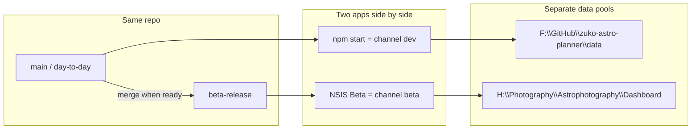

# Beta installer + Dev on F:

## Recommendation (locked)

Standalone **NSIS installer** with a **different Electron `appId`** is the right model. Same GitHub repo; branch `beta-release` for what you install. Not a fork.

## Data layout (your choices)

| Channel | How you run it | Data root | Notes |
|---|---|---|---|
| **Beta** | Installed app | `H:\Photography\Astrophotography\Dashboard` | Real use. **One-time seed** from current `zuko-dashboard-data.json` (already on H). **No** mirror into git `data/`. |
| **Dev** | `npm start` from F: clone | `F:\GitHub\zuko-astro-planner\data` | Never reads/writes H:\Dashboard. Forecast/moon caches + credits stay in that folder too. |

Not creating `H:\...\Dashboard-Dev` — Dev lives on F as you asked. (That name stays available later if you want an H mirror.)

**F:\GitHub cleanup:** today it only has `LightroomSyncMac` (no Zuko leftovers). Leave that alone; add `zuko-astro-planner` beside it. Nothing else to delete.

## Code changes

### 1. Channel detection — [`main.js`](main.js)

- `ZUKO_CHANNEL` env override if set.
- Else: `app.isPackaged` → `beta`, unpackaged → `dev`.
- Window title / menu label includes channel (`… Beta` vs `… Dev`) so you never confuse which pool is open.

### 2. Path resolution — [`main.js`](main.js) `resolveDataPaths` / `reconcileDataFiles`

- **beta:** only `H:\Photography\Astrophotography\Dashboard` (`mirrorFile: null`). Honor existing `ZUKO_DATA_DIR` override for QA.
- **dev:** unpackaged uses repo-relative `data/` next to `__dirname` (so the intentional Dev clone on F owns `F:\GitHub\zuko-astro-planner\data`). **Do not** reconcile against H:\Dashboard.
- Point `setForecastCacheDir` / `setAstronomyCacheDir` at the active channel dir (already wired to `resolveDataPaths().dir`).

### 3. Electron Builder — [`package.json`](package.json)

- Beta identity: `appId: com.alex.zukoastroplanner.beta`, `productName: Zuko Astro Planner Beta`.
- Script: `dist:win:beta` → `electron-builder --win` (NSIS).
- Bake `zukoChannel: "beta"` via `extraMetadata` in the packaged app so channel is unambiguous.

### 4. One-time beta seed — `scripts/seed-beta-dashboard.js`

- Copies current dashboard JSON into `H:\...\Dashboard\zuko-dashboard-data.json` if a marker `.beta-seeded` is absent (copy once from the freshest of H vs repo, then write marker).
- Does **not** overwrite an already-seeded beta file on later runs.
- Document in README: run once before first beta install if needed (H already has today’s file, so first install is effectively seeded).

### 5. Docs — [`README.md`](README.md)

- Short **Dev vs Beta** section: paths, how to start, how to build installer, that pools never sync.

### 6. Git / workspace

- Create branch **`beta-release`** from current `main` (push when you ask).
- Clone the repo to **`F:\GitHub\zuko-astro-planner`** as the Dev working copy. Develop with `npm start` there so Dev data stays under F.
- Current `C:\Users\alexp\Projects\zuko-astro-planner` can remain a second checkout; unpackaged always uses that checkout’s own `data/` (no hard-coded “always F” that would steal a C: checkout’s writes). Putting the clone on F *is* how Dev lands on F.

## What you get day-to-day

1. **Real use:** install Beta → works only against H:\Dashboard (seeded once from today’s JSON).
2. **Experiment:** open `F:\GitHub\zuko-astro-planner` → `npm start` → separate JSON/caches on F.
3. **Promote:** merge `main` → `beta-release` → `npm run dist:win:beta` → install over previous Beta (same `appId`, same H data).

## Out of scope (unless you ask later)

- Auto-updater / GitHub Releases pipeline
- Separate Astrospheric API keys (same `.env` / key store is fine; credit JSON is already per data dir)
- Moving ASIAIR Projects / Dark Library paths (stay on H under `Astrophotography\`)
- Deleting or relocating the C: Projects clone
