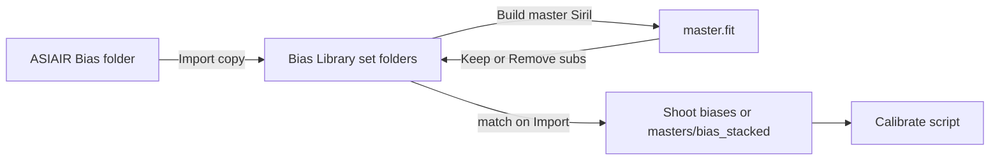

# Dark / Bias Library + Master Build

## Decisions (locked)

- **Separate roots** for housekeeping:
  - Dark: existing `F:\zuko_dev\Dark Library` / `H:\…\Zuko\Dark Library`
  - Bias (darkflats): new `F:\zuko_dev\Bias Library` / `H:\…\Zuko\Bias Library`
- Library **Import** copies ASIAIR Bias (and later Dark) **subs** into set folders.
- **Build master** runs Siril stack → one `master.fit` in the set; then **Keep subs** or **Remove subs**; UI shows status + **folder size**.
- Shoot Import uses matched **master biases** the same way as master darks (symlink from library; no per-project `_calibration/darkflats` when masters are on).

## Branch + Dev seed

1. Create branch `feat/dark-bias-library` from current `main`.
2. Ensure Dev trees exist:
   - Copy Beta Dark Library → `F:\zuko_dev\Dark Library` if Dev is empty/thin (mirror set folders).
   - Create empty `F:\zuko_dev\Bias Library` (and Beta `H:\…\Zuko\Bias Library` if missing).
3. Update path constants / seed scripts ([`index.html`](index.html), [`scripts/seed-dev-f-zuko-json.js`](scripts/seed-dev-f-zuko-json.js)) for `biasLibrary.path`.

## Data model

Extend dashboard JSON:

```json
"biasLibrary": {
  "path": "F:\\zuko_dev\\Bias Library",
  "index": [],
  "indexedAt": null
}
```

Index entries (bias + dark aligned):

- Existing dark fields: `filePath`, `exposureSec`, `gain`, `tempC`, `bin`, `date`, `ageDays`, `expired`
- New: `kind` (`sub` | `master`), `setFolder`, `filter` (from filename when present)
- Set-level rollup in UI (not necessarily separate JSON): `subCount`, `hasMaster`, `masterPath`, `sizeBytes`

On-disk bias set layout (mirrors darks):

```text
Bias Library/
  Bias_2.0s_Bin2_-10c/
    [optional L|R|H|O|S/]
      Bias_*.fit          ← imported subs
      master.fit          ← after Build master
```

## Backend ([`src/ingest/asiairIngest.js`](src/ingest/asiairIngest.js) + new helpers)

- `indexBiasLibrary(path)` — walk Bias Library like `indexDarkLibrary`; detect `master.fit`; compute set sizes.
- `matchMasterBiases({ index, exposureSec, gain, tempC, bin, filter? })` — same tolerances as darks (±0.05s / ±0.5 gain / ±3°C); prefer sets with `master.fit`; if master present, match returns the master file only.
- `importBiasSubsToLibrary({ sourceDir, libraryPath })` — scan ASIAIR `Bias/` (Autorun or Plan), group into set folders by exp/bin/temp (± filter), **copy** (never move source).
- Optional twin for darks later; first ship focuses Bias import into Bias Library (Dark Library already has frames).
- `folderSizeBytes(dir)` for UI totals.
- Stage path changes in `stageSirilTree`: when `useMasterBiases`, symlink matched master (or subs) into shoot `biases/`; skip `_calibration/darkflats`. Meta: `biasSource: "master-symlink"`, `biasLibrary: <set folder>`.

## Siril Build Master ([`src/siril/preprocess.js`](src/siril/preprocess.js))

New `buildLibraryMaster({ setDir, kind: 'bias'|'dark', removeSubs })`:

1. Work in a temp/process under the set (or `setDir/_build`).
2. Generate short `.ssf` matching calibrate’s stack lines:

```ssf
cd <subs>
convert bias -out=../_build
cd ../_build
stack bias rej 3 3 -nonorm -out=../master
```

(Same for dark → `master.fit`.)

3. On success: write `master.fit` at set root; if `removeSubs`, delete only matched sub FITS (keep `master.fit` + any logs).
4. Return `{ ok, masterPath, removedCount, sizeBytes }`.

Wire IPC in [`main.js`](main.js) / [`preload.js`](preload.js): `indexBiases`, `matchBiases`, `importBiases`, `buildMaster`, `librarySetSize`.

## Calibrate script tweak

In `buildCalibrateScript` / `calibrateShoot`: if `masters/bias_stacked.fit` (or a single linked master already placed as that name) exists **and** `biases/` is empty or marked master-only, **skip** bias convert/stack and use the pre-made master. Same pattern optional for darks when library master is staged as `masters/dark_stacked.fit`.

Practical staging rule:

- **Has master:** symlink/copy library `master.fit` → shoot `masters/bias_stacked.fit` (and leave `biases/` empty or with a marker); calibrate skips bias stack.
- **Subs only:** current behavior (link all into `biases/`, stack during Calibrate).

## UI — Calibration section ([`index.html`](index.html))

Replace single “Calibration — Dark Library” with two panels (or one section, two path rows):

**Dark Library** (existing + enhancements)

- Path, Browse, Re-index
- Table columns: Folder | Subs | Master | Size | Exp | Gain | Temp | Bin | Age
- Per-row actions: **Build master…** → confirm Keep / Remove subs
- Footer: total library size

**Bias Library** (new, parallel)

- Same controls + **Import from ASIAIR…** (source path, default Settings ASIAIR source or browse)
- Import copies into set folders, then re-index
- Build master Keep/Remove + size columns

**Shoot Import modal**

- Add checkbox: “Use matching master biases when importing” (default on when matches exist)
- Chip like Master darks: “Master bias: …”
- Readiness: Bias satisfied by library match **or** scan biases (same pattern as darks)

## Flow



## Docs / QA

- Update [`README.md`](README.md) path table + `_calibration` note (biases optional when masters used).
- Short note in [`docs/working-notes.md`](docs/working-notes.md).
- Extend [`scripts/qa-asiair-ingest.js`](scripts/qa-asiair-ingest.js) or a small library-import smoke: index bias lib, match, stage with `useMasterBiases`.

## Out of scope (this branch)

- Auto-delete of the 489-frame 7/28 dump at source (Import is copy-only).
- Changing Dark Library matching rules beyond master-prefer + size/status columns.
- Full Dark “Import from ASIAIR” (can reuse Bias import machinery in a follow-up if needed).
