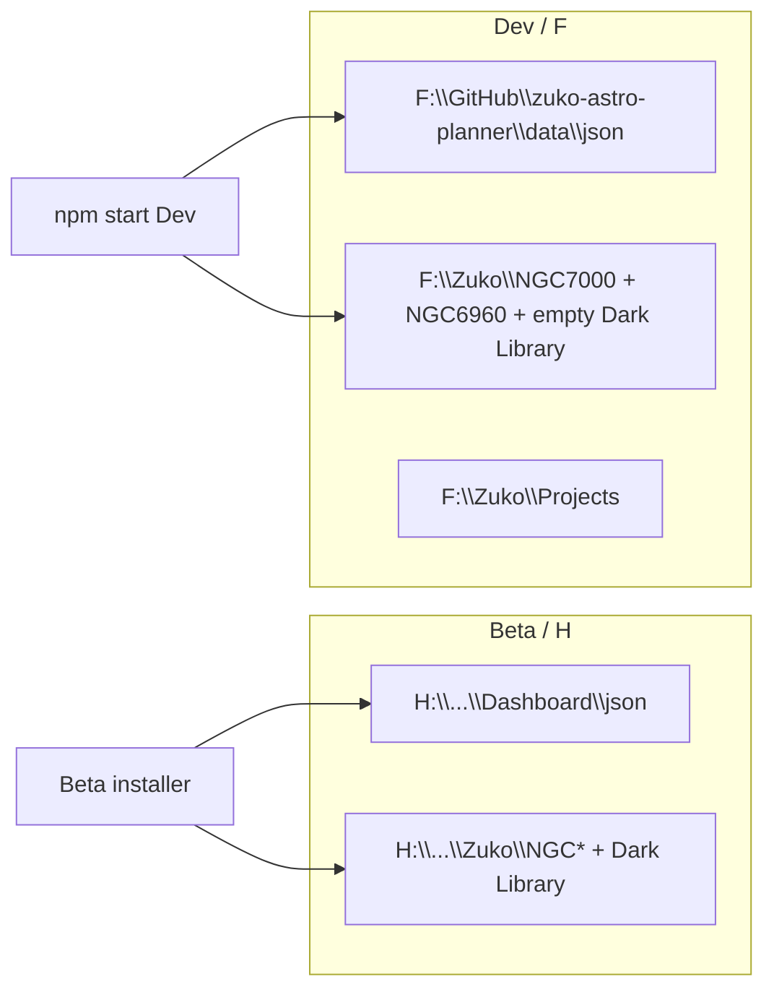

# F: Dev Siril/Sirilic data prep

## Goal

Isolate **Dev** imaging files + JSON on **F:** so Siril/Sirilic work never touches Beta/prod on **H:**.



## Layout on F: (new)

```
F:\Zuko\
  Projects\                 # Dev ingest / project-root default
  Dark Library\             # empty (placeholder only)
  NGC7000_260720\           # copy of H:\...\NGC7000_260720 (~7 GB)
  NGC6960_Q326\             # copy of H:\...\NGC6960_Q326 (~25 GB: 260725 + Sirilic + fits)
```

F: has ~960 GB free — full Veil copy is intentional so Sirilic configs under `NGC6960_Q326\Sirilic\` and staged `260725\` stay usable for integration work.

## File copies

1. `robocopy` (or equivalent)  
   - `H:\Photography\Astrophotography\Zuko\NGC7000_260720` → `F:\Zuko\NGC7000_260720`  
   - `H:\Photography\Astrophotography\Zuko\NGC6960_Q326` → `F:\Zuko\NGC6960_Q326`  
2. Create empty `F:\Zuko\Dark Library\` and `F:\Zuko\Projects\`.
3. Do **not** modify anything under H:\.

## Dev JSON retarget

Edit **only** the Dev pool: [`F:\GitHub\zuko-astro-planner\data\zuko-dashboard-data.json`](F:\GitHub\zuko-astro-planner\data\zuko-dashboard-data.json) (seed from current C: or F: copy if needed, then rewrite paths).

- **North America Nebula**: set `projectDir` to `F:\Zuko\NGC7000_260720` (currently empty; shoots have no ingest paths — that’s fine for an already-processed Siril tree).
- **Veil**: set `projectDir` to `F:\Zuko\NGC6960_Q326\260725`; rewrite any `sourcePath` / `ingestPath` / `ingestMeta` / calibration paths from `H:\...\Zuko\...` → `F:\Zuko\...`.
- **`darkLibrary`**: `{ path: "F:\\Zuko\\Dark Library", index: [], indexedAt: null }` (empty as requested).
- Leave C: / H: Beta JSON alone.

## Code: Dev must not prefer H: Projects

Today [`main.js`](main.js) `resolveProjectsRoot()` uses `H:\Photography\Astrophotography\Projects` whenever H: exists — so Dev on this machine still points at prod.

Change: when `getZukoChannel() === 'dev'`, use `F:\Zuko\Projects` (still honor `ZUKO_PROJECTS_DIR` override). Beta keeps H: behavior.

Also update Dev default dark-library hint in renderer defaults if present ([`index.html`](index.html) `defaultData.darkLibrary.path`) so new Dev sessions don’t suggest the H: library — only when channel is available / keep Beta seed on H.

## Docs

Short note in [`docs/working-notes.md`](docs/working-notes.md): F:\Zuko Dev pool layout + “Beta stays on H”.

## Verify

- Paths exist on F; sample file counts match.
- Dev JSON only references `F:\Zuko\...` for project/dark paths.
- Confirm `resolveProjectsRoot()` in Dev returns `F:\Zuko\Projects`.

## Out of scope (this prep)

- Siril/Sirilic automation itself  
- Rebuilding Beta installer  
- Copying the real Dark Library masters onto F (empty placeholder only)  
- Changing C: checkout `data/` JSON (prod/dev separation)  
