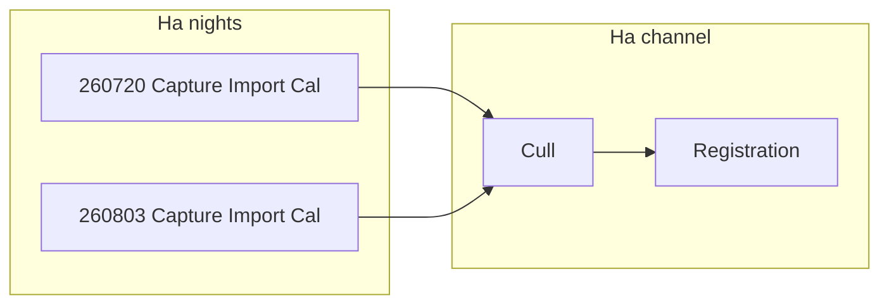

# Merged Shoot Log + Channel Pipeline

## Intent

One surface per project that reads as **process**, not a spreadsheet next to a duplicate status bar.

- **Per night (shoot log):** left → right `Capture → Import → Calibration`
- **Merge:** multiple nights (or one) converge into a **channel trunk**
- **Per channel:** `Cull → Registration` once for that filter

Capture Plan stays its own box (plan vs execute).

## Chosen layout (pipeline-first)

Each filter channel is a card (reuse tone colors from current `.pipeline-channel`):

1. **Channel header** — filter name + short rollup (`2 nights · 1.25h logged · cal 1/2`)
2. **Night rails** — one row per shoot for that tone, sorted by date  
   - Identity: `YYMMDD` (+ location if multiple capture-plan rows share the filter)  
   - Compact meta chip: planned/actual hours and lights×exp when `ingestMeta` exists  
   - L→R **actionable** steps (not duplicate Status/Import/Calibrate columns):  
     - Capture → `toggleShootComplete`  
     - Import → `openIngestModal` (gated like today)  
     - Calibration → `runPreprocessShoot` (gated like today)  
   - Overflow `⋯` / expand: name edit, remove, full meta (temp/gain/paths) — replaces the wide table
3. **Merge cue** — light connector or “joins channel” gutter when `nights ≥ 2`; single-night still shows the trunk (merge of one)
4. **Channel trunk row** — `Cull` (toggle) + `Registration` button/dot, same gates as now (`getFilterCalibrationProgress` + `isFilterCullComplete`)
5. **Section footer** — `+ Plan Shoot`, `Review source`, `Import all` (move from old Shoot Log actions)

Empty channel (filter in Capture Plan, no shoots): header + “No nights yet” + trunk locked.

## What goes away / stays

| Today | After |
|--------|--------|
| Shoot Log table + separate Pipeline bars | One **Imaging Pipeline** (or **Channel Pipeline**) section |
| Status / Import / Calibrate button columns | Same actions on night-rail steps |
| Dense always-on columns | Compact chip + expand for detail |
| Capture Plan table | Unchanged above this section |

Data model unchanged: `shoots[]` for nights; `filterTargets[].cullMeta` / `stackMeta` for channel; existing helpers in [`index.html`](index.html) (`listPipelineFilterGroups`, `getShootsForFilterTone`, `runPreprocessShoot`, `registerAndStackFilterTone`, `toggleFilterCull`).

## Implementation touchpoints

- [`index.html`](index.html): replace Shoot Log + Pipeline mounts in `renderProjects()` (~7431–7522) with `renderChannelPipelineSection(project, pi)`
- Refactor current `renderShootPipelineRow` / `renderFilterChannelPipelineFooter` / `renderFilterPipelineBar` into the richer night rail + trunk (wire onclick on Capture/Import/Cal steps; keep Registration btn)
- CSS: extend `.pipeline-channel` for merge gutter, compact meta, expandable detail; drop reliance on wide `.shoot-log-table` in the default view
- Collapse state: reuse `shootLogCollapsed` (or rename to `channelPipelineCollapsed`) for the whole section
- E2E: [`e2e/smoke.spec.js`](e2e/smoke.spec.js) — assert channel cards + `.pipeline-filter-row` / night rails instead of Shoot Log table visibility where needed
- Note in [`docs/working-notes.md`](docs/working-notes.md)

## Interaction rules (preserve behavior)

- Capture before Import; Import before Calibrate; all imported nights calibrated before Cull; Cull before Registration
- Re-calibrate any night still clears that channel’s `cullMeta` / `stackMeta`
- Multi-location same filter remains one channel (existing `filterToneKey` merge); night label shows location when needed

## Out of scope

- In-app cull UI (still stub dot + Siril `culled.txt`)
- Changing Siril calibrate/stack APIs
- Folding Capture Plan into the pipeline
