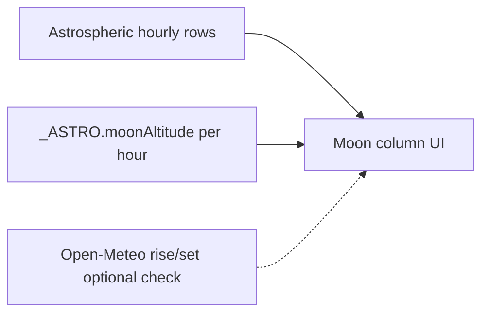

# Moon column on Sky Forecast hourly rows

## Research summary (what we have today)

| Source | What it gives | Good for hourly rows? |
|--------|---------------|------------------------|
| **Astrospheric `/api/Moon`** (10 credits, ~24h cache) | One **snapshot**: illumination %, phase angle, **alt/az**, `IsAboveHorizon`, next phases — **not** RA/Dec, **not** hourly | No — only “now” at fetch time |
| **Astrospheric forecast** | Hourly cloud / transparency / seeing | No moon fields |
| **Open-Meteo daily** | `moonrise` / `moonset` / `moon_phase` (16 days) | Yes for up/down windows; coarse near rise/set |
| **Local `_ASTRO`** in [`index.html`](index.html) | `getMoonTimes`, **`moonAltitude(date, lat, lon)`** already exported | **Best** for per-hour altitude |

Astrospheric already returns alt/az on the Moon card path ([`src/weather/skyAstronomy.js`](src/weather/skyAstronomy.js) `normalizeMoonPayload`) but those fields are unused in the UI. That snapshot cannot drive a 3-night hourly grid.

**Rise/set alone** answers “up or down” but not “how high” (a moon at 5° vs 60° matters for gradients / NB). **Altitude (Az/Alt frame)** is what imagers care about for sky brightness. **RA/Dec** is mainly useful later for *angular separation to your target* (e.g. Veil) — valuable for NB, but a second feature.

**Why Siril-style “angle” = altitude here:** for each forecast hour at your site, altitude above horizon is the natural “is it in the sky / how bad is it” number. Azimuth is optional (where to look) and noisier for a narrow column.

## Chosen UX (default)

Add a **Moon** column after Local (or before RAG) on each night’s hourly table:

- Below horizon: muted `—` or `↓`
- Above horizon: `↑ 42°` (altitude, integer degrees)
- Tooltip: rise/set for that calendar night when known (Open-Meteo or `_ASTRO.getMoonTimes`)
- No illumination % in the cell (night summary already shows moon emoji + illum); keeps the table readable
- No extra Astrospheric credits

## Implementation (branch `moon-angle-implementation`)

1. **Helper** next to existing `_ASTRO` / sky forecast render in [`index.html`](index.html):
   - `moonHourStatus(iso, lat, lon)` → `{ up: boolean, altDeg: number|null }` via `_ASTRO.moonAltitude`
   - Treat `altDeg > 0` as up (same convention as horizon crossing; optional tiny negative pad later if needed)

2. **Wire into** the hourly `<tr>` builder (~7864–7917): new `<th>Moon</th>`, cell, `colgroup`, colspan updates.

3. **Pass lat/lon** already used by `renderSkyForecastPanel` into that map (same site as forecast).

4. **QA:** small unit asserts in [`scripts/qa-sky-astro-modules.js`](scripts/qa-sky-astro-modules.js) (or a thin helper if we extract altitude to a tiny shared module) — known date/lat: moon above vs below horizon matches Open-Meteo rise/set roughly.

5. **Docs:** one line in [`docs/external-data.md`](docs/external-data.md) — hourly Moon column is local math, not Astrospheric.

## Explicitly out of scope (follow-ups)

- Astrospheric hourly moon / more Moon API pulls
- Showing RA/Dec or target–moon angular separation (good Phase 2 once projects’ `savedTarget` is wired)
- Changing RAG to penalize high moon (tonightShoot already has an illumination penalty concept — separate decision)

## Why not rise/set-only?

Rise/set from Open-Meteo is already on the Moon card. For hourly planning, altitude answers “how much sky glow” in one glance; rise/set alone can’t.