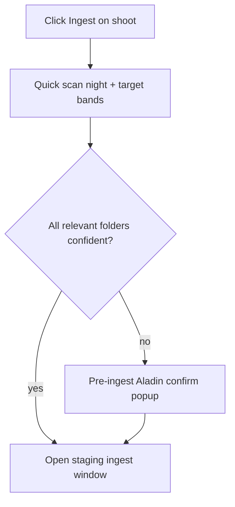

# RA/Dec target match + Aladin confirm

## Intent
Match ASIAIR `Light/<folder>` dumps to the project using FITS `RA`/`DEC` vs `savedTarget`. Name/catalog matching is fallback only.

**Critical UX change:** when the match is **not confident**, show a **dedicated confirm popup first** (before the staging/ingest window). Only after the user decides do we open the normal ingest/staging modal.

If confidence is high (auto band), skip confirm and open ingest directly.

## Match policy (defaults)
Per ASIAIR `Light/<folder>` for the shoot’s night:

1. Read light `RA`/`DEC`; compute angular distance to `savedTarget`.
2. Use **median** separation per folder.
3. Bands:
   - **confident (auto):** median ≤ **0.75°** → include, no popup
   - **uncertain (confirm):** **0.75°–2.5°**, or name-only / no coords when ambiguous → **pre-ingest confirm popup**
   - **other target:** **> 2.5°** → excluded by default; still shown in confirm if user might force-include, or listed as other in ingest if we skipped confirm because another folder was already confident
4. No `savedTarget`: if multiple Light folders → confirm required; if one folder → open ingest with warning status.
5. Flats/Bias/Dark stay shared (not target-gated).

## Pre-ingest confirm popup (before staging window)
Triggered from **single-shoot Ingest** when any candidate folder is `uncertain` (or multi-folder with no clear auto match).

Layout:
- Title: e.g. `Confirm target — Ha 260728`
- Sub: separation + ASIAIR folder / OBJECT vs planner `savedTarget.name`
- **Two Aladin panes side by side:**
  - **Left — Shot log / planner:** `savedTarget` RA/Dec, name, optional FOV hint
  - **Right — ASIAIR dump:** median RA/Dec of the folder under review, folder name, light count, median sep
- Necessary text under panes: coords, separation in degrees, band reason
- Actions: **This is my target** / **Not this target** (and Next if multiple uncertain folders for that night)
- Cancel closes without opening ingest

Reuse Aladin init from project framer (`aladin-framer-*` in [index.html](index.html)); destroy on close.

If user accepts → stash `includeTargets` → open normal ingest modal filtered to those folders.
If user rejects all → don’t open ingest (or open with Stage locked + clear message).

## Ingest modal: target-match status
Inside the staging window, add a clear **status icon/button** (chip or badge near project/sources line) showing how this ingest bound to a target, e.g.:

- green **Target matched** (auto, ≤0.75°) — click opens read-only summary (coords + sep)
- yellow **Target confirmed** (user accepted in pre-popup)
- red/amber **Target uncertain** should not normally appear once gated; if no savedTarget / no coords single-folder warn → yellow **Target assumed**
- muted **Other target excluded** count if far folders were dropped

Clicking the control can re-open the Aladin compare in read-only mode (optional but useful).

## Ingest all: one-by-one confirms
For **Ingest all**:

1. Discover nights/queues as today.
2. For each pending shoot (or each distinct uncertain ASIAIR folder×night needed by the batch), if band is uncertain → run the **same confirm popup**, one after another.
3. After all uncertain items are resolved (or user cancels a step → skip that shoot / abort batch with message), open the multi ingest staging UI with accumulated `includeTargets` (and per-night maps if needed).
4. Confident shoots skip the popup entirely.

Do not open the staging window until the confirm queue is finished.

## Backend ([src/ingest/asiairIngest.js](src/ingest/asiairIngest.js))
- Extend `HEADER_KEYS` + parse for `RA`/`DEC`.
- `angularSeparationDeg(...)`.
- Scan returns `targets[]`: `{ folder, name, lightCount, medianRa, medianDec, separationDeg, band }`.
- `includeTargets: string[]` on scan/stage to keep only those Light folders.
- Lightweight path used by pre-confirm: same `scanSession` (or thin wrapper) before modal open.

## Wiring ([index.html](index.html))
- `openIngestModal` / `ingestAllCapturedShoots`: run target resolution **before** showing `#ingest-overlay`.
- New overlay `#ingest-target-confirm-overlay` (sibling to ingest/restage overlays).
- `ingestCtx.includeTargets`, `ingestCtx.targetMatchMeta` for status chip.
- `runIngestScan` uses resolved includes; does not re-prompt unless user clears match.

## Error handling
- Missing RA/DEC → uncertain if other folders exist; single folder → assumed + status warn.
- No savedTarget → confirm when >1 folder.
- Aladin init failure → text-only coords + separation still allow Accept/Reject.
- Cancel on confirm → do not open staging window.

## Tests / docs
- QA: near / mid / far synthetic RA-Dec folders; `includeTargets` stage filter.
- README + short go-live note on thresholds (0.75° / 2.5°).
