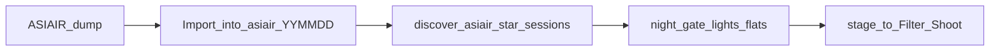

# Flatten Veil project root + multi-night ASIAIR ingest

## What you meant

- **Project folder** = `NGC6960_Q326` (not `…\260725`).
- **Filter / shoot / `_calibration` / `working`** live directly under that root (same shape as NAN Dev: `NGC7000_260720\Ha|OIII|SII|_calibration|working`).
- Typo clarified: move contents **from** `…\NGC6960_Q326\260725\` **up into** `…\NGC6960_Q326\`.

Do this on **both**:
- Beta: `H:\Photography\Astrophotography\Zuko\NGC6960_Q326`
- Dev: `F:\zuko_dev\Projects\NGC6960_Q326` (already partly flat — has top-level `Autorun`/`SII`/`_calibration` **and** a `260725` folder; merge carefully)

---

## Phase 1 — Flatten migration (do first)

Branch from `main`: `fix/veil-project-root` (or similar).

### Disk moves

For each of H: and F: Veil trees:

1. Move `260725\SII\…` → `NGC6960_Q326\SII\…` (merge if top-level `SII` already exists).
2. Move `260725\_calibration\…` → `NGC6960_Q326\_calibration\…`.
3. Move `260725\Autorun\…` → decide destination (see Phase 2 default below). For a minimal flatten that keeps ingest working today: move to `NGC6960_Q326\Autorun\` (discover already requires Autorun/Plan as **direct children** of `projectDir`).
4. Leave `Sirilic\` and any `.fit` finals at project root untouched.
5. Remove empty `260725` when done.
6. Do **not** touch Beta live dumps until paths in JSON are updated in the same change set.

Script (recommended): `scripts/flatten-veil-night-folder.js` that:
- Takes `--root` (H or F path)
- Moves with conflict checks (no silent overwrite)
- Prints a dry-run by default; `--apply` to execute

### Dashboard JSON

Update `projectDir` / `ingestPath` / `ingestMeta.destRoots` / calib paths:

- Beta: `H:\Photography\Astrophotography\Dashboard\zuko-dashboard-data.json`
- Dev: `C:\Users\alexp\Projects\zuko-astro-planner\data\zuko-dashboard-data.json`

`projectDir` → `…\NGC6960_Q326`  
`ingestPath` / destRoots → `…\NGC6960_Q326\SII\260725_SII_B5_Queechy`  
Fix any doubled-backslash path bugs while touching Beta JSON.

Also fix reset/seed helpers that hardcode Veil night path:
- [`scripts/reset-dashboard-pre-ingest.js`](scripts/reset-dashboard-pre-ingest.js) (`devDir` / `betaDir`)
- [`scripts/seed-dev-f-zuko-json.js`](scripts/seed-dev-f-zuko-json.js)

### UI polish already drafted (ship on same branch)

Already in working tree on C:: project-dir ellipsis + light-mode SII/filter contrast in [`index.html`](index.html). Include those in this branch so they don’t sit on the old feature branch forever.

### Verify

- Dev + Beta open Veil → Project directory shows `…\NGC6960_Q326`, truncated cleanly.
- Ingest discover still finds `Autorun` under the new root.
- Existing staged SII shoot still resolves on disk.

---

## Phase 2 — Multi-night Autorun/Plan (design we lock in)

**Problem:** One shared `Autorun` at project root mixes nights; biases/darks are not night-gated today, so stale calib from other nights can pollute a shoot. Discover is **non-recursive** (only direct `Autorun`/`Plan` children).

**Chosen model** (matches current stage layout + NAN):

```text
NGC6960_Q326/                    ← projectDir
  asiair/
    260725/Autorun|Plan/…        ← one ASIAIR dump per night
    260803/Autorun|Plan/…
  SII|Ha|OIII/<ShootCode>/       ← Siril stage (unchanged)
  _calibration/…                 ← Siril calib (unchanged)
  working/
```



### Code changes (after flatten)

1. **[`src/ingest/asiairIngest.js`](src/ingest/asiairIngest.js) — `discoverSessions`**
   - Keep today’s: direct `Autorun`/`Plan` under `projectDir` (compat).
   - Add: `asiair/<any>/Autorun` and `asiair/<any>/Plan`.
   - Optional later: also accept `asiair/<YYMMDD>` that *is* the session (Light/Flat/Bias as children).

2. **Scan for a shoot**
   - Prefer sessions under `asiair/<shoot.date>/` when that folder exists.
   - Else fall back to all discovered sessions + existing DATE-OBS night gate for lights/flats.
   - Tighten bias/dark selection when an `asiair/<date>` dump exists: prefer calib from that dump first (reduce stale cross-night calib).

3. **UI: “Import ASIAIR dump…”** on Shoot Log / Review source
   - Pick a folder (USB/`ASIAIR_*` volume).
   - Copy into `projectDir/asiair/<YYMMDD>/` (derive date from folder name or newest light DATE-OBS).
   - Do **not** stage yet — then user hits Ingest on the matching shoot.

4. **Docs** — update [`README.md`](README.md) ASIAIR section + a short working-notes entry: project root vs `asiair/<night>` vs Filter/Shoot.

### Explicitly deferred (not this branch)

- Live “ASIAIR connected” auto-watch / Wi‑Fi pull — note as follow-up once Import + `asiair/<date>` discover works.
- Flattening NAN on H: (still letter folders H/O/S) — out of scope unless you want it later.

---

## Suggested order of work

1. Create branch from `main`.
2. Land UI path/SII fixes.
3. Write + dry-run flatten script; apply H: then F:; update both JSONs + seed/reset paths.
4. Implement `asiair/<date>` discover + import affordance + README.
5. Smoke: Veil ingest on a second night folder without touching the already-staged SII shoot.
